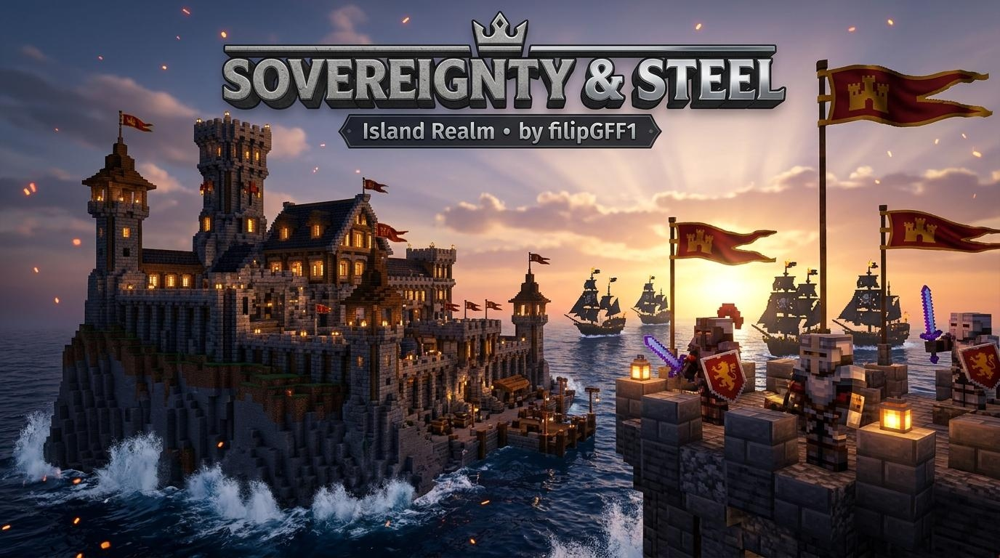

# ⚔️ Sovereignty & Steel: Island Realm (1.21.4)
**The Ultimate Island Nation, Geopolitical & Civilization Plugin for Modern Minecraft Servers**  
**Official Author & Lead Developer**: `filipGFF1` • **Version**: `1.0.0 (Community Edition)` • **Platform**: Paper / Purpur 1.21.4



---

## 🌟 Overview

**Sovereignty & Steel: Island Realm** is a next-generation geopolitical, kingdom management, and territorial warfare engine engineered specifically for Minecraft 1.21.4 island survival and civilization servers.

Unlike traditional town or claim plugins that treat the world as a flat, boring grid, **Sovereignty & Steel** turns your server into a living, breathing oceanic archipelago of rival empires, trade networks, automated fortress walls, and maritime warfare. Players don't just "claim land" — they found dynasties, choose from 8 distinct political doctrines, commission legendary generals, defend against pirate flotillas, and build self-repairing battlements.

> [!IMPORTANT]
> **Anti-Plagiarism & Authenticity Certification**:  
> This software contains immutable licensing signatures verifying **`filipGFF1`** as the sole author and creator (`AUTHOR = "filipGFF1"`, signature `SOVEREIGNTY-STEEL-v1.0.0-FILIPGFF1-ORIGINAL`). Server administrators cannot remove or tamper with developer credits. Commands like `/country author`, `/panstwo autor`, console startup watermarks, and GUI headers permanently guarantee the plugin's authenticity.

---

## 🌐 Multi-Language Localization Engine

Sovereignty & Steel comes with complete out-of-the-box internationalization. On a clean installation, the plugin greets players and server owners in **English (`en`)** by default.

In your `plugins/SovereigntyAndSteel/config.yml`, administrators can easily switch languages or customize every single message:

```yaml
# ========================================================
#       SOVEREIGNTY & STEEL - CONFIGURATION
#       Plugin by: filipGFF1
# ========================================================
# Available built-in languages:
#   en - English (Default international standard)
#   pl - Polski (Pelne polskie tlumaczenie)
#   es - Espanol (Traduccion completa al espanol)
locale: en
```

Every language file (`messages_en.yml`, `messages_pl.yml`, `messages_es.yml`) is fully customizable with hex colors and MiniMessage support. If any custom key is omitted or missing in a translated file, the engine automatically falls back to English to prevent console errors.

---

## 🛡️ Localized Commands & Native Aliases

Players on international servers can comfortably use commands in their native language:

### English Commands (Default):
- `/country` (or `/nation`, `/kingdom`, `/sovereignty`) — Opens the main management dashboard and command guide.
- `/country create <name> <tag>` — Founds a new island realm and awards the mystical **Bastion Core**.
- `/country bank` (or `/bank`, `/treasury`) — Inspects the National Treasury, Vault balance, and daily Upkeep status.
- `/country deposit <amount>` / `/country withdraw <amount>` — Financial transactions with the National Treasury.
- `/country vault [1-5|upgrade|autosell]` — Accesses multi-page secure storage and configures Auto-Sell liquidation.
- `/country claim` (or `/claim`) — Assimilates the current chunk into the nation's borders with anti-abuse cooldowns.
- `/country unclaim` (or `/unclaim`) — Relinquishes the current chunk back to the untamed wilderness.
- `/country wall` — Opens the interactive border fortification and automated wall management GUI.
- `/country regime` — Opens the Political Doctrine selection menu (8 unique doctrines).
- `/country tech` (or `/country upgrades`) — Opens the national technology research tree (Tier I to V).
- `/country color <#HEX>` — Customizes nation territory border colors on web maps (Squaremap, Dynmap, BlueMap, Pl3xMap).
- `/country territory` (or `/teren`, `/land`) — Inspects the allegiance of the chunk you are currently standing in.
- `/country recipes` (or `/crafting`) — Interactive 3x3 recipe book showcasing all custom items and siege engines.
- `/country invite <player>` / `/country join <name>` / `/country leave` — Citizen recruitment and membership.
- `/country war <nation>` / `/country relation <ally|nap|neutral|rival> <nation>` — International diplomacy and warfare.
- `/country surrender` — Formally surrenders a war (cedes 25% territory, 70% treasury, and establishes tribute).
- `/country siegewindow <from> <to>` — Configures your 3-to-4 hour daily bastion defense window to prevent offline raids.
- `/country general` (or `/country drumroll`) — Activates General Paolo Or'e's War March combat aura.
- `/country tribute` — Negotiates and pays tributes to pirate fleets.
- `/country trash` (or `/trash`, `/kosz`) — Portable item disposal bin.
- `/country sit` (or `/sit`) — Sit down on stairs, slabs, chairs, or flat ground.
- `/country author` (or `/country about`, `/country version`) — Displays official developer credentials for `filipGFF1`.
- `/tc <message>` — Encrypted town / nation internal chat channel.
- `/ac <message>` — Allied cross-nation communication channel.

### Polish Commands (`pl`):
- `/panstwo` (lub `/kraj`) — Główne menu zarządzania państwem wyspiarskim.
- `/panstwo stworz <nazwa> <tag>` / `/panstwo zapros <gracz>` / `/panstwo dolacz <nazwa>` — Zarządzanie obywatelami.
- `/panstwo bank` / `/panstwo wplac` / `/panstwo wyplac` / `/panstwo skarbiec` — Finanse i skarbiec narodowy.
- `/panstwo claim` / `/panstwo unclaim` / `/panstwo mur` / `/panstwo ustroj` / `/panstwo upgrady` — Terytorium i doktryny.
- `/panstwo autor` — Oficjalny certyfikat autorstwa twórcy `filipGFF1`.

### Spanish Commands (`es`):
- `/pais` (o `/reino`) — Menú principal de gestión de la nación isleña.
- `/pais crear <nombre> <tag>` / `/pais invitar <jugador>` / `/pais unirse <nombre>` — Reclutamiento de ciudadanos.
- `/pais banco` / `/pais depositar` / `/pais retirar` / `/pais tesoro` — Economía y tesoro nacional.
- `/pais reclamar` / `/pais renunciar` / `/pais muro` / `/pais regimen` / `/pais tecnologia` — Doctrina y territorio.
- `/pais autor` — Credenciales oficiales del desarrollador `filipGFF1`.

---

## 🏰 Deep Gameplay Mechanics

### 1. Bastion Cores & Capital Founding
When founding a nation (`/country create`), the sovereign receives an ancient **Bastion Core**. Placing this artifact on an island anchors the capital city:
- Creates an impenetrable core territorial claim.
- Radiates a protective aura granting citizens regeneration and mining haste.
- Acts as the central anchor that enemy fleets must breach during wartime.

### 2. The 8 Geopolitical Regimes
Every kingdom chooses an ideological doctrine that fundamentally alters economic and military gameplay:
1. **Merchant Republic**: +25% vault profits, reduced trade tariffs, passive interest on deposits.
2. **Feudal Monarchy**: +20% citizen melee damage, reduced fortress construction costs.
3. **Naval Thalassocracy**: Increased ship speed, naval artillery buffs, double rewards from pirate raids.
4. **Militant Hegemony**: Faster troop recruitment, reinforced wall integrity, rapid siege recovery.
5. **Scholastic Arcana**: Reduced enchantment lapis costs, potion brewing boosts, research speed +30%.
6. **Industrial Guild**: Automated smelting efficiency, miner haste II aura, +15% ore output.
7. **Nomadic Corsairs**: Boarding bonuses, grappling hook agility, plunder loot multipliers.
8. **Eldritch Theocracy**: Mob repulsion shields, nighttime combat buffs, totem preservation.

### 3. Self-Repairing Bastion Walls
Fortress blocks damaged during skirmishes or pirate artillery strikes automatically regenerate over time using stored stone and cobblestone from the national vault. Never spend hours manually patching griefed stone walls again.

### 4. Automated Trade & Sovereign Vault
Citizens deposit agricultural and mineral surpluses directly into the island vault. At configured dawn intervals, the vault automatically liquidates designated goods into server currency, funding kingdom expansion and army upkeep.

### 5. High-Seas Pirate Raids
Periodically, randomized pirate dreadnoughts and skeleton corsairs spawn off the coast. Garrison troops must man coastal cannons, repel boarding parties, and salvage sunken treasure galleons.

### 6. Short Tactical Shield (Buckler)
Specially engineered for agile island skirmishers and duelists (`CustomModelData: 1001`):
- **+10% Sprint Mobility**: Eliminates the heavy movement penalty of standard vanilla shields.
- **50% Faster Axe Recovery**: Recovers from axe parry strikes in half the time.
- **Custom Parry FX**: Plays high-pitch defensive deflections with golden spark particles.
- **3x3 Crafting Recipe**: 3 Wood Planks + 1 Iron Ingot + 3 Wood Planks (viewable via `/country recipes`).

---

## ⚙️ Installation & Requirements

1. Drop **`sovereignty-steel.jar`** into your server's `/plugins/` folder.
2. Ensure you are running **Paper**, **Purpur**, or compatible **1.21.4** software with **Java 21**.
3. (Optional) Install **Vault** + an economy plugin (like EssentialsX) to enable sovereign treasury trade.
4. Restart your server. The default configuration and locale files will be automatically generated.

---

## 🔑 Permissions Summary

| Permission Node | Default | Description |
| :--- | :--- | :--- |
| `sovereignty.user` | `true` (Everyone) | Standard player commands (create, join, vault, recipes) |
| `sovereignty.leader` | `op` / Leaders | Leadership commands (regime selection, disband, diplomatic war) |
| `sovereignty.admin` | `op` (Administrators) | Full access to administrative bypass, force disband, and debugging tools |

---

<div align="center">
  <b>Developed with passion by filipGFF1</b><br>
  <i>Official 2026 Minecraft Island Nation Engine • All Rights Reserved</i>
</div>
